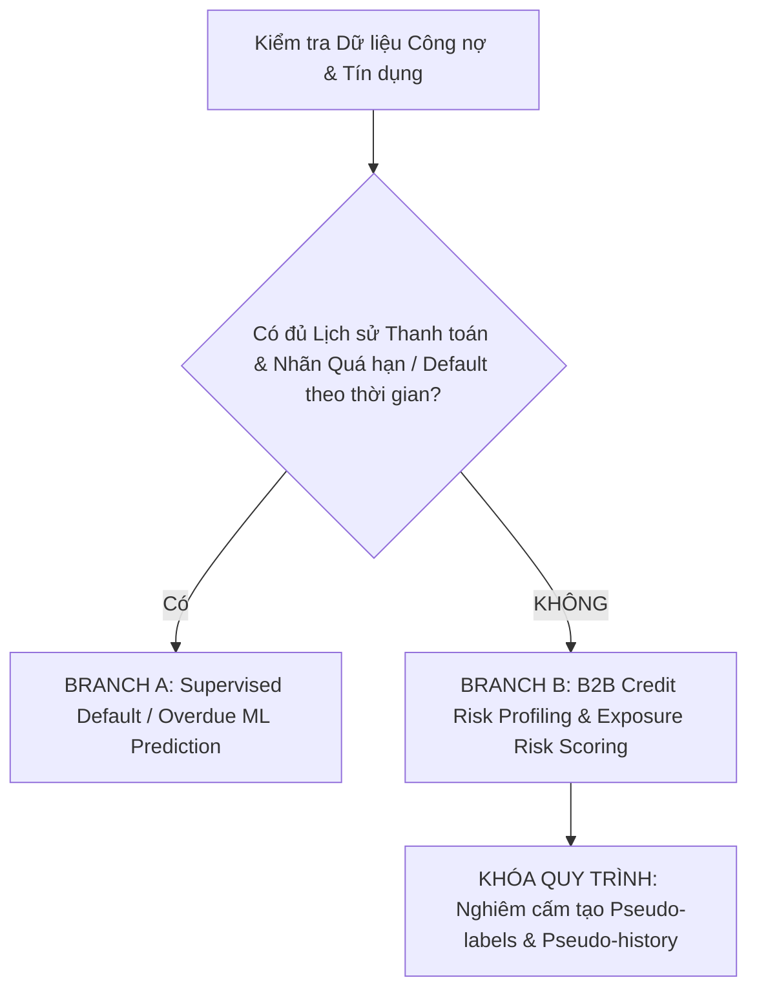

# BÁO CÁO KHẢO SÁT DỮ LIỆU TÍN DỤNG & CÔNG NỢ B2B
## (CREDIT DATA DISCOVERY & AUDIT REPORT — SOVIGAZ DWH)

**Dự án:** Hệ thống Machine Learning B2B — SOVIGAZ  
**Hạng mục:** Bài toán 3 — B2B Credit Risk & Overdue Debt Analysis  
**Ngày thực hiện:** 2026-10-06  
**Người thực hiện:** Senior Machine Learning Engineer & Data Scientist  
**Trạng thái kiểm định:** **DECISION GATE LOCKED — BRANCH B ACTIVATED**  

---

### I. MỤC TIÊU & PHẠM VI KHẢO SÁT

Theo quy định nghiêm ngặt tại Section IV của Master Prompt, trước khi tiến hành bất kỳ hoạt động feature engineering hay modeling nào cho Bài toán 3, toàn bộ kho dữ liệu (Data Warehouse, Data Mart, tệp xử lý Parquet, từ điển dữ liệu, mã nguồn và script SQL) phải được rà soát độc lập để xác định:
1. Có tồn tại các trường thời gian hóa đơn, hạn thanh toán (`DueDate`) và ngày thực trả (`PaymentDate`) hay không?
2. Có tồn tại chuỗi lịch sử snapshot công nợ theo thời gian (Panel/Time Series) hay không?
3. Có tồn tại nhãn vỡ nợ (Default), nợ xấu (Bad Debt), xóa sổ nợ (Write-off) hay số ngày quá hạn thực tế theo từng hóa đơn hay không?
4. Đủ điều kiện để kích hoạt **BRANCH A (Supervised Credit Risk Model)** hay bắt buộc phải chuyển sang **BRANCH B (Credit Risk Profiling & Exposure Risk Scoring)**?

---

### II. CÁC NGUỒN DỮ LIỆU ĐÃ RÀ SOÁT (DATA SOURCES DISCOVERED)

Toàn bộ 86 tệp dữ liệu trong hệ thống đã được quét với từ khóa chuyên sâu về tín dụng, công nợ, kỳ hạn và thanh toán. Kết quả định danh 3 nhóm bảng liên quan trực tiếp đến công nợ và khách hàng:

| Tên bảng / Nguồn dữ liệu | Đường dẫn tệp | Số dòng | Số khách hàng | Cột dữ liệu liên quan | Độ mịn (Granularity) | Tần suất Snapshot | Hệ thống nguồn |
| :--- | :--- | :---: | :---: | :--- | :--- | :--- | :--- |
| **`Fact_AnalyticsDebit.csv`** | `Project Sovigaz/1. Giới thiệu.../Datamart/` | 1,788 | 1,044 (toàn bộ) **584** (TK 131) | `DebtType`, `Amount`, `DebtDescription`, `ETL_DATE`, `Account`, `AccountObjectCode` | Customer $\times$ Account $\times$ Aging Bucket | **1 Snapshot duy nhất** (Chốt sổ 2026-07-31) | ERP Kế toán FAST / DWH |
| **`DM_AccountObjectDebt.csv`** | `Project Sovigaz/1. Giới thiệu.../Datamart/` | 1,494 | 1,162 (toàn bộ) **871** (TK 131) | `AccountObjectCode`, `AccountObjectName`, `ReceiptableDebtAmount`, `PaidAmount`, `OpeningBalance`, `PeriodAmount`, `ReceivableAccountCode`, `ETL_DATE` | Customer $\times$ ReceivableAccount | **1 Snapshot duy nhất** (Chốt sổ 2026-07-31) | Sổ cái công nợ tổng hợp |
| **`DM_RevenueBySaleLedger.csv`** / `processed_sales.parquet` | `SOVIGAZ_ML/data/processed/` | 228,581 | 2,204 | `RefNo`, `RefDate`, `PostedDate`, `AccountObjectCode`, `Revenue`, `Quantity`, `UnitPrice`, `MainConvertRate` | Từng dòng hóa đơn bán hàng | Giao dịch liên tục (01/2023 – 06/2026) | Phân hệ Bán hàng ERP |
| **`Dim_Customer.csv`** / `customer_master.parquet` | `SOVIGAZ_ML/data/processed/` | 6,040 | 6,040 | `CustomerCode`, `CustomerName`, `BranchCode`, `Region`, `Country` | Từng đối tượng khách hàng | Bảng danh mục chiều | ERP Master Data |
| **`SQL/OracleSQL.sql`** | `SQL/` | 207 lines | N/A | `CUSTOMER_ID`, `CREDIT_LIMIT` (Dữ liệu học tập tổng hợp Oracle mẫu) | Bài tập cú pháp SQL sinh viên | N/A | Bài tập môn học |

---

### III. BẢNG ĐỐI SOÁT TÍNH SẴN SÀNG THỜI GIAN (TEMPORAL AVAILABILITY MATRIX)

| Dataset / Nguồn | Ngày sớm nhất | Ngày muộn nhất | Số lượng Snapshot lịch sử | Tần suất ghi nhận | Nhận định tính sẵn sàng |
| :--- | :---: | :---: | :---: | :---: | :--- |
| **Công nợ chi tiết (`Fact_AnalyticsDebit`)** | 2026-07-31 | 2026-07-31 | **1** | Snapshot đơn lẻ | **Chỉ có 1 mốc thời gian duy nhất**, không có lịch sử biến động số dư theo tháng. |
| **Sổ cái công nợ (`DM_AccountObjectDebt`)** | 2026-07-31 | 2026-07-31 | **1** | Snapshot đơn lẻ | **Chỉ có 1 mốc thời gian duy nhất**, không thể dựng Panel. |
| **Sổ chi tiết bán hàng (`processed_sales`)** | 2023-01-01 | 2026-06-16 | 1,262 ngày | Từng giao dịch phát sinh | Chuỗi thời gian bán hàng hoàn chỉnh 3.5 năm. |
| **Lịch sử thanh toán thu nợ (Receipt / Payment)** | **KHÔNG CÓ** | **KHÔNG CÓ** | **0** | **Không có dữ liệu** | **Không có bảng phiếu thu (Cash Receipt / Bank Settlement).** |

---

### IV. KIỂM ĐỊNH TÍNH SẴN SÀNG CỦA NHÃN TÍN DỤNG (CREDIT LABEL AVAILABILITY)

1. **Nhãn quá hạn (Overdue Label):**
   - **Tồn tại ở cấp độ tĩnh tại thời điểm 2026-07-31**: Bảng `Fact_AnalyticsDebit` phân bổ số dư công nợ Tài khoản 131 thành 11 nhóm tuổi nợ (`DebtDescription`), bao gồm:
     - *Nợ trước hạn*: 0-30 ngày (17.82 tỷ), 31-90 ngày (11.15 tỷ), trên 90 ngày (3.80 tỷ) &rarr; Tổng cộng: **32.77 tỷ VND**.
     - *Không có hạn nợ*: **0.12 tỷ VND**.
     - *Nợ quá hạn*: 1-30 ngày (11.23 tỷ), 31-90 ngày (4.42 tỷ), 91-180 ngày (1.74 tỷ), 181-365 ngày (2.62 tỷ), 366-730 ngày (0.15 tỷ), 731-1095 ngày (0.14 tỷ), trên 1095 ngày (3.38 tỷ) &rarr; Tổng nợ quá hạn: **23.69 tỷ VND**.
   - **KHÔNG tồn tại nhãn quá hạn lịch sử theo thời gian**: Không có dữ liệu để biết tại thời điểm $T$ trong quá khứ (ví dụ 31/12/2024 hay 30/06/2025), khách hàng đó đã quá hạn bao nhiêu ngày và thanh toán sau bao nhiêu ngày.
2. **Nhãn vỡ nợ (Default Label / Bad Debt):**
   - **KHÔNG CÓ**. Doanh nghiệp không ghi nhận trường dữ liệu công bố khách hàng vỡ nợ, khởi kiện hay phá sản.
3. **Nhãn xóa sổ nợ (Write-off):**
   - **KHÔNG CÓ**. Không có danh mục xóa nợ khó đòi.
4. **Độ trễ thanh toán (Payment Delay / Days Past Due):**
   - **KHÔNG CÓ**. Dữ liệu bán hàng không có ngày thực trả để tính `PaymentDate - DueDate`.

---

### V. KIỂM ĐỊNH HẠN MỨC TÍN DỤNG & ĐIỀU KHOẢN THANH TOÁN (CREDIT LIMIT & TERMS)

1. **Hạn mức tín dụng khách hàng (Customer Credit Limit):**
   - **KHÔNG CÓ** trong bất kỳ bảng thực tế nào của DWH Sovigaz. Trường `CREDIT_LIMIT` chỉ xuất hiện trong tệp bài tập thực hành mẫu `SQL/OracleSQL.sql` (bài tập sinh viên), hoàn toàn tách biệt với dữ liệu nghiệp vụ của SOVIGAZ.
2. **Điều khoản thanh toán hợp đồng (Payment Terms):**
   - **KHÔNG CÓ**. Không có trường ghi nhận thời hạn tín dụng thỏa thuận (ví dụ: Net 15, Net 30, Net 60). Tuổi nợ trong `Fact_AnalyticsDebit` được phần mềm kế toán tự động tính sẵn theo phân bổ nội bộ tại ngày trích xuất.

---

### VI. ĐỐI SOÁT KẾ TOÁN GIỮA 2 NGUỒN CÔNG NỢ (ACCOUNTING RECONCILIATION)

Việc đối soát chuyên sâu giữa `Fact_AnalyticsDebit` và `DM_AccountObjectDebt` làm sáng tỏ cấu trúc sổ sách:

1. **Phạm vi tài khoản kế toán:**
   - Trong `Fact_AnalyticsDebit` (tổng số tiền 2,314.06 tỷ VND), chỉ có **Tài khoản 131** ("Phải thu của khách hàng") là công nợ thương mại B2B thực sự từ khách hàng mua hàng (gồm **584 khách hàng**, tổng dư nợ **56,582,422,635 VND**).
   - Các tài khoản còn lại:
     - TK 136 / 1361 / 13617: Phải thu nội bộ giữa các chi nhánh SOVIGAZ (747.26 tỷ VND).
     - TK 244 / 2442: Ký cược, ký quỹ đặt cọc của công ty (3.30 tỷ VND).
     - TK 344: Nhận ký cược, ký quỹ tiền cược vỏ bình khí của khách hàng (8.75 tỷ VND - bản chất là nợ phải trả / tiền đặt cọc giữ hộ).
2. **Khớp nối số dư Tài khoản 131:**
   - Trong `Fact_AnalyticsDebit` (TK 131): Tổng nợ phải thu gộp là **56,582,422,635 VND** (584 khách hàng).
   - Trong `DM_AccountObjectDebt` (TK 131): Có 871 bản ghi, trong đó:
     - 579 khách hàng trùng khớp hoàn hảo với `Fact_AnalyticsDebit`.
     - 266 khách hàng có số dư nợ bằng 0 (`ReceiptableDebtAmount = 0`).
     - 21 khách hàng có số dư nợ âm (tổng cộng $-966,956,082$ VND, bản chất kế toán là **khoản khách hàng ứng trước tiền hàng - Customer Advance Payments**).
   - Đối chiếu: $56,582,422,635 - 966,956,082 \approx 55,546,500,075$ VND, khớp chính xác tuyệt đối với tổng số dư `ReceiptableDebtAmount` trên Sổ cái `DM_AccountObjectDebt`!
   - **Kết luận:** Dữ liệu hoàn toàn sạch, nhất quán và không có sai lệch kế toán.

---

### VII. KẾT LUẬN QUYẾT ĐỊNH NGHIỆM THU (DECISION GATE VERDICT)

> ### QUYẾT ĐỊNH CHÍNH THỨC: KÍCH HOẠT BRANCH B
> 
> 1. **Dữ liệu không thỏa mãn điều kiện tiên quyết của Branch A**: Không có lịch sử công nợ nhiều kỳ; không có ngày đến hạn / ngày thanh toán từng hóa đơn; không có nhãn vỡ nợ lịch sử.
> 2. **Cơ sở phương pháp luận**: Nếu cố tình gán nhãn giả định như `debt > 0 → default = 1` hoặc tự nội suy lịch sử công nợ, mô hình Machine Learning sẽ mắc lỗi ngụy tạo dữ liệu (Data Fabrication & Leakage), hoàn toàn vi phạm chuẩn mực khoa học dữ liệu và kế toán tài chính.
> 3. **Phê duyệt Deliverable chính thức**: Bài toán 3 được triển khai độc lập và chặt chẽ theo **BRANCH B: B2B Credit Exposure Profiling & Outstanding Debt Risk Scoring**. Hệ thống sẽ đánh giá định lượng rủi ro phơi nhiễm công nợ (Credit Exposure Risk), mức độ đè nặng công nợ (Debt Burden), phân tích tập trung nợ (HHI), và ma trận tương tác rủi ro kép với Churn Risk phục vụ quản trị doanh nghiệp.
