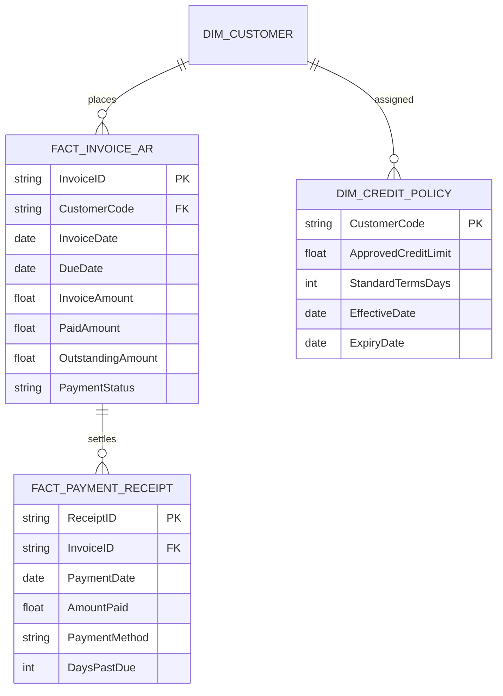

# LỘ TRÌNH THU THẬP DỮ LIỆU ĐỂ PHÁT TRIỂN MÔ HÌNH HỌC MÁY RỦI RO TÍN DỤNG
## (CREDIT RISK DATA GAP & PIPELINE EXPANSION ROADMAP — SOVIGAZ DWH)

**Dự án:** Hệ thống Phân tích Dữ liệu & Machine Learning B2B — SOVIGAZ  
**Mục tiêu:** Định nghĩa chuẩn hóa dữ liệu cần bổ sung để tiến từ *Credit Exposure Profiling (Branch B)* lên *Supervised Credit Default & Payment Delay Prediction (Branch A)*  
**Ngày lập:** 2026-10-06  
**Tác giả:** Senior Machine Learning Engineer & Data Scientist  

---

### I. HIỆN TRẠNG DỮ LIỆU VÀ KHOẢNG TRỐNG (CURRENT STATE & DATA GAPS)

Audit tại Bài toán 3 cho thấy SOVIGAZ hiện chỉ có **01 snapshot tĩnh ngày 31/07/2026** của bảng công nợ tổng hợp và phân loại tuổi nợ do phần mềm kế toán trích xuất tự động:
1. **Khoảng trống 1 — Thiếu Ngày đến hạn (`DueDate`):** Dữ liệu hóa đơn bán hàng (`processed_sales`) chỉ có ngày lập chứng từ (`RefDate`) và ngày hạch toán (`PostedDate`). Do đó, hệ thống không thể tính toán được thời hạn tín dụng thỏa thuận của từng đơn hàng.
2. **Khoảng trống 2 — Thiếu Sổ quỹ Phiếu thu thanh toán (`PaymentDate` & `Receipts`):** Không có bảng ghi nhận từng lần khách hàng chuyển khoản hoặc trả tiền mặt để đối trừ (reconciliation) với hóa đơn phát hành. Do đó, không thể tính toán số ngày thanh toán trễ (`Days Past Due = PaymentDate - DueDate`).
3. **Khoảng trống 3 — Thiếu Chuỗi Thời gian Công nợ (Historical Panel):** Bảng `Fact_AnalyticsDebit` chỉ được lưu tại một thời điểm, không có lịch sử biến động số dư cuối tháng qua các năm 2023, 2024, 2025.
4. **Khoảng trống 4 — Thiếu Hạn mức Tín dụng Phê duyệt (`CreditLimit`):** Doanh nghiệp quản lý công nợ theo kinh nghiệm và thỏa thuận riêng, chưa đưa hạn mức tín dụng trần vào cơ sở dữ liệu DWH.

---

### II. KIẾN TRÚC DỮ LIỆU BẮT BUỘC ĐỂ TIẾN TỚI SUPERVISED ML (REQUIRED SCHEMA)

Để có thể huấn luyện các mô hình học máy dự báo vỡ nợ (Probability of Default - PD), tổn thất khi vỡ nợ (Loss Given Default - LGD) hoặc dự báo số ngày thanh toán trễ (Payment Delay Regression), SOVIGAZ cần mở rộng Data Warehouse với 2 bảng dữ liệu hạt nhân:

#### 1. Bảng Chi tiết Hóa đơn Công nợ Phải thu (`Fact_Invoice_AR`)
- `InvoiceID` *(Khóa chính)*: Mã hóa đơn tài chính duy nhất.
- `CustomerCode` *(Khóa ngoại)*: Mã khách hàng (`AccountObjectCode`).
- `InvoiceDate`: Ngày xuất hóa đơn.
- `DueDate` *(Trường bắt buộc)*: Ngày đến hạn thanh toán theo hợp đồng.
- `InvoiceAmount`: Tổng giá trị hóa đơn (gồm VAT).
- `PaidAmount`: Số tiền lũy kế đã thanh toán cho hóa đơn này.
- `OutstandingAmount`: Số dư nợ còn lại của hóa đơn này.
- `PaymentStatus`: Trạng thái hóa đơn (`PAID`, `PARTIALLY_PAID`, `OVERDUE`, `UNPAID`).

#### 2. Bảng Lịch sử Phiếu thu & Đối trừ Thanh toán (`Fact_Payment_Receipt`)
- `ReceiptID` *(Khóa chính)*: Mã phiếu thu / giao dịch ngân hàng.
- `InvoiceID` *(Khóa ngoại)*: Mã hóa đơn được thanh toán.
- `PaymentDate` *(Trường bắt buộc)*: Ngày khách hàng chuyển tiền thực tế.
- `AmountPaid`: Số tiền thực trả trong lần thanh toán này.
- `DaysPastDue` *(Tính toán)*:
  $$\text{DaysPastDue} = \max(0, \text{PaymentDate} - \text{DueDate})$$

#### 3. Bảng Chính sách & Hạn mức Tín dụng (`Dim_Credit_Policy`)
- `CustomerCode`: Mã khách hàng.
- `ApprovedCreditLimit`: Hạn mức tín dụng tối đa được phê duyệt (VND).
- `StandardTermsDays`: Thời hạn thanh toán chuẩn (ví dụ: 15, 30, 45, 60 ngày).
- `RiskGrade`: Xếp hạng tín nhiệm nội bộ ban đầu.
- `CollateralAmount`: Giá trị tài sản bảo đảm / tiền ký cược bình khí (nếu có).

---

### III. CÁC BIẾN MỤC TIÊU CÓ THỂ ĐỊNH NGHĨA KHI ĐỦ DỮ LIỆU

Khi 3 bảng dữ liệu trên được tích hợp và vận hành tối thiểu từ **12 đến 24 tháng**, hệ thống sẽ đủ điều kiện kích hoạt các bài toán Supervised ML nâng cao:

1. **Bài toán 1 — Dự báo Khách hàng Thanh toán Quá hạn trong chu kỳ tiếp theo (Overdue Prediction):**
   - Định nghĩa Target: $Y = 1$ nếu khách hàng phát sinh ít nhất một hóa đơn bị quá hạn $> 30$ ngày trong 60 ngày tiếp theo.
   - Ứng dụng: Cảnh báo sớm để phòng ban Kế toán chủ động nhắc nợ trước khi đến hạn.
2. **Bài toán 2 — Dự báo Vỡ nợ / Nợ xấu Khó đòi (Probability of Default - PD):**
   - Định nghĩa Target chuẩn Basel II: $Y = 1$ nếu khách hàng có khoản nợ quá hạn $> 90$ ngày liên tục hoặc công ty phải thực hiện biện pháp pháp lý / xóa sổ nợ.
   - Mô hình ứng viên: **Logistic Regression with WoE**, **CatBoostClassifier**, **LightGBM**.
   - Metric nghiệm thu: **PR-AUC**, **ROC-AUC $\ge 0.80$**, **Brier Score $\le 0.10$**, **KS Statistic $\ge 40$**.
3. **Bài toán 3 — Dự báo Số ngày Trễ hạn (Payment Delay Forecasting):**
   - Định nghĩa Target: Số ngày chênh lệch $\text{DaysPastDue}$ của các hóa đơn phát hành trong tháng tới.
   - Ứng dụng: Tối ưu hóa dự báo dòng tiền thu hồi thực tế cho Ban Tài chính.

---

### IV. LỘ TRÌNH TRIỂN KHAI 4 GIAI ĐOẠN (ROADMAP TIMELINE)

| Giai đoạn | Thời gian dự kiến | Mục tiêu trọng tâm | Trách nhiệm chính | Sản phẩm chuyển giao |
| :--- | :---: | :--- | :--- | :--- |
| **Giai đoạn 1: Chuẩn hóa ERP & Trích xuất** | Tháng 1 – 2 | Bổ sung trường `DueDate` vào module Bán hàng; kích hoạt module ghi nhận phiếu thu liên kết hóa đơn (`Fact_Payment_Receipt`). | Phòng IT & Phòng Kế toán | Dữ liệu hóa đơn có `DueDate` và `PaymentDate` bắt đầu được lưu trữ chuẩn xác. |
| **Giai đoạn 2: Tích lũy Lịch sử (Accumulation)** | Tháng 3 – 14 | Tích lũy chuỗi thời gian thanh toán liên tục tối thiểu 12 tháng; tự động lưu snapshot số dư công nợ cuối mỗi tháng vào DWH. | Kỹ sư Dữ liệu (Data Engineer) | Bảng Panel công nợ 12 tháng hoàn chỉnh (`Fact_Monthly_Debt_Snapshot`). |
| **Giai đoạn 3: Xây dựng Feature Store & Nhãn ML** | Tháng 15 – 16 | Tạo Feature Store tín dụng: Lịch sử trễ hạn, tỷ lệ tận dụng hạn mức, đà thanh toán; dán nhãn target $Y_{90d}$. | Kỹ sư ML (ML Engineer) | Bộ dữ liệu huấn luyện ML tín dụng không rò rỉ thông tin tương lai. |
| **Giai đoạn 4: Huấn luyện & Triển khai Model PD** | Tháng 17 – 18 | Huấn luyện và kiểm định mô hình PD Supervised; phân tích SHAP; tích hợp API chấm điểm tự động khi tạo đơn hàng. | Data Scientist / MLOps | Mô hình Supervised Credit Risk chính thức đi vào sản xuất (Branch A). |

---

### V. KẾT LUẬN

Việc dừng lại ở **Branch B (Credit Risk Profiling & Exposure Scoring)** trong giai đoạn hiện tại là hoàn toàn chính xác về mặt khoa học. Lộ trình thu thập dữ liệu trên cung cấp bản thiết kế chi tiết để SOVIGAZ từng bước số hóa toàn diện quy trình quản trị tín dụng thương mại B2B, chuẩn bị nền tảng dữ liệu vững chắc cho các bài toán Trí tuệ Nhân tạo thế hệ tiếp theo.
