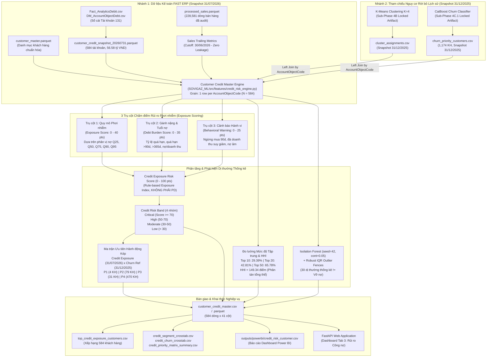

# SOVIGAZ ML — PROBLEM 3: B2B CREDIT RISK & OVERDUE DEBT
# FINAL DATA LINEAGE & TEMPORAL ARCHITECTURE

---

**Dự án:** Hệ thống Machine Learning B2B — SOVIGAZ  
**Hạng mục:** BÀI TOÁN 3.1 — FINAL DATA LINEAGE & TEMPORAL TRACEABILITY  
**Trạng thái:** **AUDITED / LOCKED**  
**Chuẩn tuân thủ:** Strict Dual-Snapshot Lineage & Non-Leakage Architecture  

---

## 1. KIẾN TRÚC DÒNG DỮ LIỆU ĐẦU-CUỐI (END-TO-END DATA LINEAGE)

Hệ thống phân tích rủi ro phơi nhiễm công nợ (Problem 3) tích hợp dữ liệu từ 2 nhánh độc lập với mốc thời gian rõ ràng:
1. **Nhánh Phơi nhiễm Công nợ (Credit Exposure Branch):** Chốt sổ kế toán tại **$T_{\text{credit}} = \text{2026-07-31}$** (FAST ERP).
2. **Nhánh Tham chiếu Rời bỏ Lịch sử (Historical Churn Reference Branch):** Đánh giá tại snapshot **$T_{\text{churn}} = \text{2025-12-31}$** (Mô hình CatBoost đã khóa từ Sub-Phase 4C/4D).

---

## 2. CHI TIẾT CÁC TẦNG DỮ LIỆU & QUY TRÌNH BIẾN ĐỔI (DATA STAGES & TRANSFORMATIONS)

### 2.1. Tầng Nguồn (Source Layer)
- **Tập tin công nợ gốc:** `Fact_AnalyticsDebit.csv` (1,011 giao dịch công nợ) và `DM_AccountObjectDebt.csv` (danh mục đối tượng công nợ từ hệ thống FAST ERP).
- **Snapshot Date:** `2026-07-31` (Timestamp xuất file ETL: `2026-08-02 11:27:14`).
- **Tập tin chuẩn hóa:** `data/processed/customer_credit_snapshot_20260731.parquet`.
  - Hạt nhân dữ liệu (Grain): 1 dòng = 1 mã đối tượng công nợ (`AccountObjectCode`).
  - Số lượng: **584 khách hàng có số dư nợ**.
  - Tổng dư nợ: **56,582,422,635 VND**.

### 2.2. Tầng Ghép nối Đặc trưng Doanh số (Sales Exposure Trailing Metrics)
- **Nguồn:** `data/processed/processed_sales.parquet` (228,581 dòng bán hàng đã được làm sạch, không duplicate).
- **Điểm ngắt dữ liệu (Cutoff Date):** `2026-06-30` (trước thời điểm snapshot công nợ 1 tháng, bảo đảm không rò rỉ dữ liệu tương lai).
- **Đặc trưng tính toán:**
  - `revenue_365d`, `revenue_180d`, `revenue_90d`, `revenue_30d`: Doanh số thuần bán hàng trong các cửa sổ trượt.
  - `transaction_count_365d`: Số hóa đơn duy nhất (`COUNT(DISTINCT RefNo)`).
  - `active_days_365d`: Số ngày có phát sinh mua hàng.
  - `revenue_momentum_ratio`: Tỷ số đà doanh số $= \text{revenue\_30d} / (\text{revenue\_90d} / 3)$.

### 2.3. Tầng Tích hợp Mô hình Phân khúc & Mô hình Rời bỏ (Segmentation & Churn Integration)
- **Phân khúc K-Means (Sub-Phase 4B):** Ghép nối từ `outputs/customer_segmentation/cluster_assignments.csv` tại snapshot `2025-12-31`. Phân loại khách hàng vào 4 cụm:
  - *Key Industrial Accounts* (205 khách hàng nợ 32.81 tỷ VND).
  - *Active Regular Buyers* (155 khách hàng nợ 4.18 tỷ VND).
  - *Slipping / Periodic Buyers* (45 khách hàng nợ 0.85 tỷ VND).
  - *Dormant (Clustered)* (17 khách hàng nợ 0.48 tỷ VND).
  - Khách hàng không mua trong năm 2025 được gán nhãn: *Dormant / Non-Clustered* (162 khách hàng nợ 18.26 tỷ VND).
- **Tham chiếu Nguy cơ Rời bỏ (Sub-Phase 4D):** Ghép nối từ `outputs/churn/churn_priority_customers.csv` tại snapshot `2025-12-31`.
  - Có 412 khách hàng công nợ có điểm dự báo rời bỏ từ mô hình CatBoost.
  - 172 khách hàng không phát sinh mua bán trong giai đoạn huấn luyện 2025 được gán nhãn rõ ràng: `churn_risk_band = "Not Evaluated in 2025"`, `churn_snapshot_date = "Not Evaluated in 2025"`, `churn_probability = -1.0`.

---

## 3. CẤU TRÚC THANG ĐIỂM RỦI RO PHƠI NHIỄM (CREDIT EXPOSURE RISK SCORE)

Thang điểm từ 0 đến 100 điểm, minh bạch và giải thích được 100% các thành phần:

$$\text{Credit Exposure Risk Score} = \text{Exposure Score (40)} + \text{Debt Burden Score (35)} + \text{Behavioral Warning Score (25)}$$

| Trụ cột | Thang điểm | Nhân tố thành phần & Công thức quy đổi |
| :--- | :---: | :--- |
| **Pillar 1: Quy mô Phơi nhiễm (Exposure Scale)** | 0 – 40 pts | - Dư nợ $\ge P95$ (493.7M): 40 điểm - Dư nợ $\ge P90$ (246.3M): 32 điểm - Dư nợ $\ge P75$ (57.4M): 24 điểm - Dư nợ $\ge P50$ (17.5M): 16 điểm - Dư nợ $\ge P25$ (3.3M): 8 điểm - Dư nợ $< P25$: 4 điểm |
| **Pillar 2: Gánh nặng & Tuổi nợ (Debt Burden & Aging)** | 0 – 35 pts | - Tỷ lệ quá hạn: $\text{overdue\_ratio} \times 15.0$ (tối đa 15 pts) - Cờ quá hạn $> 90$ ngày: $+8.0$ điểm - Cờ quá hạn mãn tính $> 365$ ngày: $+7.0$ điểm - Tỷ số Nợ / Doanh số 365 ngày ($\ge 1.0$: $+5$ pts; $\ge 0.5$: $+3$ pts; $\ge 0.25$: $+1$ pt) |
| **Pillar 3: Cảnh báo Hành vi (Behavioral Warnings)** | 0 – 25 pts | - Ngừng mua hàng trong 90 ngày gần nhất khi đang nợ: $+10.0$ điểm - Đà doanh thu suy giảm nghiêm trọng ($\text{momentum} < 0.25$): $+7.0$ điểm - Khách hàng có doanh thu âm do điều chỉnh kế toán: $+5.0$ điểm - Không phát sinh doanh số cả năm 365 ngày: $+3.0$ điểm |

---

## 4. MA TRẬN ĐỐI CHIẾU THỜI GIAN (TEMPORAL ALIGNMENT RECONCILIATION)

| Thành phần dữ liệu | Snapshot Date | Cửa sổ dữ liệu | Bản chất nghiệp vụ | Ràng buộc diễn giải |
| :--- | :---: | :---: | :--- | :--- |
| **Credit Exposure** | `2026-07-31` | Tích lũy đến 31/07/2026 | Sổ cái Tài khoản 131 FAST ERP | Số dư công nợ thực tế tại ngày chốt sổ. |
| **Sales Exposure** | Cutoff `2026-06-30` | 30d, 90d, 180d, 365d | Giao dịch bán hàng lịch sử | Zero future-leakage, tính đến trước kỳ công nợ. |
| **Customer Segmentation** | `2025-12-31` | 365 ngày (năm 2025) | Phân cụm K-Means 4 nhóm | Chân dung khách hàng năm 2025. |
| **Churn Risk Reference** | `2025-12-31` | 365 ngày (năm 2025) | Dự báo rời bỏ 90 ngày (Q1/2026) | **Tham chiếu lịch sử, offset 7 tháng so với công nợ.** |
| **Credit × Churn Matrix** | **Dual Snapshot** | Offset = 7 tháng | Đối chiếu chéo 2 góc nhìn | **KHÔNG diễn giải là Current Joint Risk.** |

---

## 5. RANH GIỚI KHOA HỌC & TUÂN THỦ NGUYÊN TẮC (EPISTEMIC BOUNDARIES)

1. **Không phải Xác suất Vỡ nợ (Not Probability of Default):**
   - Điểm số là chỉ số phơi nhiễm theo luật kế toán và chính sách tín dụng thương mại.
   - Không được gọi là PD do thiếu nhãn vỡ nợ lịch sử (historical default outcomes).
2. **Tuổi nợ > 3 năm không đồng nghĩa với Vỡ nợ:**
   - 3.38 tỷ VND công nợ quá hạn trên 3 năm từ 42 khách hàng là khoản phải thu thuộc nhóm tuổi nợ trên 3 năm cần được Finance ưu tiên rà soát khả năng thu hồi và đánh giá nhu cầu trích lập dự phòng theo chính sách kế toán áp dụng.
3. **Dị thường thống kê không đồng nghĩa với Vỡ nợ hay Gian lận:**
   - 30 khách hàng được Isolation Forest và Robust IQR cảnh báo là các trường hợp có cấu trúc công nợ/doanh số lệch khỏi phân phối chung, không phải mặc định là nợ xấu hay gian lận.
4. **Đối chiếu Churn × Credit mang tính tham chiếu lịch sử:**
   - Nhóm Priority 1 (4 khách hàng) là nhóm có dư nợ cao tại 31/07/2026 và từng có rủi ro rời bỏ cao tại snapshot 31/12/2025, phản ánh nhóm khách hàng cần hành động can thiệp phối hợp khẩn cấp giữa Finance và Sales.
